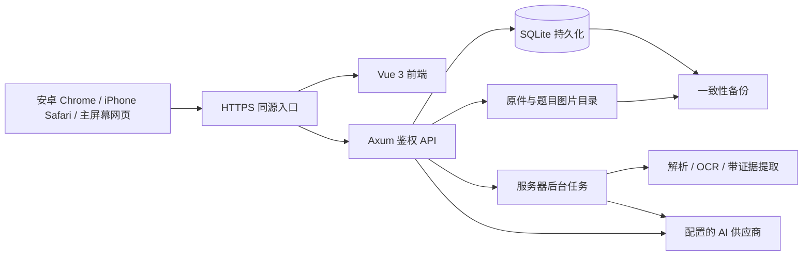

# 个人手机刷题软件 PRD

| 文档项 | 内容 |
|---|---|
| 项目 | Brush-the-questions（暂用名：个人刷题） |
| 文档版本 | v0.1，需求评审稿 |
| 编写日期 | 2026-11-19 |
| 产品负责人 / 验收人 | 项目使用者；最终由用户确认 |
| 产品形态 | 自托管手机网页，安卓 Chrome / iPhone Safari，支持添加到主屏幕 |
| 基础项目 | Exameow：Vue 3 + Rust/Axum 自托管路径 |
| 当前阶段 | 仅完成需求及协作规范；尚未实现、部署或完成设备验收 |
| 仓库 | <https://github.com/michaell2006727/Brush-the-questions> |

> 产品原则：保留文档原题和原答案。AI 只整理已有题目、按需讲解，不生成新题，不补答案，不覆盖原答案或人工修订。
>
> 本文标注“建议默认”的数值和规则用于形成可执行方案，尚不是用户已确认的业务决定；评审后调整。未标为现有能力的内容均为建设要求。

## 目录

1. [背景、目标与成功标准](#1-背景目标与成功标准)
2. [用户与使用场景](#2-用户与使用场景)
3. [版本范围与优先级](#3-版本范围与优先级)
4. [术语与不可违反的规则](#4-术语与不可违反的规则)
5. [信息架构与页面要求](#5-信息架构与页面要求)
6. [文档导入与处理任务](#6-文档导入与处理任务)
7. [提取、答案匹配与来源证据](#7-提取答案匹配与来源证据)
8. [校对、确认入库与去重](#8-校对确认入库与去重)
9. [题库、章节、收藏与导入导出](#9-题库章节收藏与导入导出)
10. [练习流程与每题保存](#10-练习流程与每题保存)
11. [判分与答案规则](#11-判分与答案规则)
12. [错题生命周期](#12-错题生命周期)
13. [限时模拟考试](#13-限时模拟考试)
14. [AI 讲解与供应商配置](#14-ai-讲解与供应商配置)
15. [同步、版本与并发](#15-同步版本与并发)
16. [统计与历史记录](#16-统计与历史记录)
17. [登录、安全与个人资料保护](#17-登录安全与个人资料保护)
18. [数据模型与接口边界](#18-数据模型与接口边界)
19. [技术方案与上游改造](#19-技术方案与上游改造)
20. [手机体验与非功能要求](#20-手机体验与非功能要求)
21. [备份、恢复与部署](#21-备份恢复与部署)
22. [验收矩阵与发布门槛](#22-验收矩阵与发布门槛)
23. [实施顺序、风险与待确认项](#23-实施顺序风险与待确认项)

## 1. 背景、目标与成功标准

### 1.1 背景与问题

用户已有 PDF、Word、Excel 题目文档，希望直接用原题复习。文档可能出现题后答案、文末集中答案、跨页题目、题目配图、扫描件和缺答案等情况。手工整理成本高，直接让模型生成题目又会改变题意或引入不可靠答案。

用户同时使用安卓和 iPhone，需要同一份题库、练习进度和错题记录，而不是每台设备单独导入、分别保存。产品采用个人服务器保存数据，手机浏览器作为访问入口。

Exameow 已有题型、题卡、练习和文档处理基础，但原版以 AI 生成题目及本地保存为主。其服务器考试中继不等于个人题库服务，具体差距见 [上游核查记录](docs/upstream-review.md)。

### 1.2 产品目标

- G-01：文档原题可追溯、可校对、可修订，集中答案不串题。
- G-02：同一个人跨手机登录服务器，继续已保存的练习，错题和收藏一致。
- G-03：覆盖导入 → 校对 → 入库 → 练习 → 错题复习 → 模考的完整个人流程。
- G-04：用户主动调用自己的 AI 接口获取讲解，AI 内容独立保存。
- G-05：资料仅向已登录用户开放，数据可备份并实际恢复。

### 1.3 首个可用版本成功标准

导入一份带答案的真实文档，逐题校对并入库；安卓 Chrome 和 iPhone Safari 登录同一账号后，均能展示题目和图片、提交答案、记录错题、刷新续做、跨设备继续进度，并主动调用配置的 AI 查看和复用讲解。

通过上述主链路只说明“首个可用闭环通过”；完整 V1 验收还须覆盖三种文档、扫描件、异常处理、模考、登录及备份恢复。不得用单份 Excel 成功替代其他格式验收。

## 2. 用户与使用场景

### 2.1 角色和权限

首版仅一个私人使用者：可登录、导入、校对、管理题库、练习、配置 AI、备份和恢复。设备是同一个账号的不同客户端，不是不同用户。

未登录访客只能访问登录页及不含隐私的服务健康信息；无公开注册、访客题库和公开练习链接。服务器运维通过受保护的部署环境操作，不设置公众管理员入口。

### 2.2 核心场景

| 场景 | 触发与操作 | 预期结果 |
|---|---|---|
| 导入试卷 | 上传带集中答案的 PDF | 题干与答案分别定位，匹配不确定项突出显示，校对后才入库 |
| 快速整理 | 上传规范 Excel，映射列 | 直接解析，不默认调用 AI，保留工作表、行号和图片 |
| 扫描复习资料 | 上传扫描 PDF | OCR 后逐页可核对，不确定字符与图片关联可修改 |
| 通勤刷题 | 从首页继续上次练习 | 回到上次已保存位置，已提交题目及结果保持一致 |
| 更换手机 | 安卓提交数题后切到 iPhone | 获取服务器最新会话，不要求重新导入 |
| 查漏补缺 | 进入错题重练 | 错误累计，连续答对达到阈值移出，可人工移出 |
| 遇到难题 | 提交后点击 AI 讲解 | 按原题、已确认参考答案讲解，单独标识 AI，不改题 |
| 文档没答案 | 校对后以待补充状态入库 | 可背题；不能自动判分、进入评分模考或调用标准答案型讲解 |
| 数据迁移 | 备份后在新实例恢复 | 题库、原件、图片、进度、错题与讲解完整且关联可用 |

## 3. 版本范围与优先级

P0 为首个可用闭环及安全前提；P1 为完整 V1 必须完成的扩展流程。P1 并不表示删除需求，可分阶段交付。P2 明确不纳入首版。

| 编号 | 需求 | 优先级 | 完成依据 |
|---|---|---|---|
| IMP-01 | PDF、DOCX、XLSX 导入；扫描 PDF OCR；原文件保存 | P0 | AC-01～05 |
| IMP-02 | 提取原题、选项、原答案、原解析、章节和图片 | P0 | AC-01～06 |
| IMP-03 | 题后与集中答案匹配、来源定位、异常标记 | P0 | AC-04、06、07 |
| REV-01 | 导入草稿、人工修改、校对、确认入库 | P0 | AC-07～10 |
| BNK-01 | 命名、章节、搜索、题目编辑、确认删除 | P0 | AC-11、12 |
| BNK-02 | 题库导入导出、图片与来源可迁移 | P1 | AC-13 |
| PRA-01 | 顺序、随机、章节、答题卡、每题保存、续做 | P0 | AC-14、19、20 |
| PRA-02 | 背题与收藏练习 | P1 | AC-15 |
| GRD-01 | 按原答案判客观题、填空变体、简答自判 | P0 | AC-16 |
| WRG-01 | 自动收录、重练、人工移出、连续答对移出 | P0 | AC-17 |
| EXM-01 | 限时模考、自动交卷、记录 | P1 | AC-18 |
| AIX-01 | 原题提取与讲解接口分离；拒绝编题补答案 | P0 | AC-09、21～23 |
| AIX-02 | 后端供应商配置、用户点击、讲解独立保存 | P0 | AC-21、24 |
| SYN-01 | 服务器题库与记录持久化、跨设备、冲突处理 | P0 | AC-19、20 |
| STA-01 | 练习次数、正确率、错题数量、模考历史 | P1 | AC-25 |
| SEC-01 | 单人登录、业务与文件鉴权、Key 保护 | P0 | AC-24、26 |
| OPS-01 | Docker、HTTPS、SQLite 和附件持久化、备份恢复 | P0 | AC-27、28 |
| MOB-01 | 四个底栏入口、手机适配、主屏幕入口 | P0 | AC-29 |

不在 V1：完整离线答题与离线合并、多用户及班级、付费系统、公开题库市场、考试发布给他人、AI 编题、AI 补答案、AI 简答评分、拍照搜题、通用聊天、录屏搜题、原生 APK / iOS 应用、桌面 Tauri 构建、Workers 部署。

文档格式边界建议：V1 Word 明确支持 `.docx`，Excel 明确支持 `.xlsx`；旧 `.doc` / `.xls` 上传时提示转换，不伪称已解析。若用户实际样本依赖旧格式，须先扩充范围和测试样本再发布。

## 4. 术语与不可违反的规则

| 术语 | 定义 |
|---|---|
| 原件 | 用户上传的文件字节，校验哈希后保存，不被 AI 或编辑器改写 |
| 原题 / 原答案 / 原解析 | 原件中实际存在的内容及其证据；缺失不是空字符串意义上的错误答案 |
| 整理结果 | 解析器或 AI 从原件提取的候选字段，不因生成成功就成为可信题库 |
| 人工修订 | 用户对提取结果的修改；保留修改前值、修改后值、时间和依据 |
| 有效参考答案 | 经校对确认的原答案，或用户明确补录/纠正且有标记的参考答案；用于判分，来源可区分 |
| 待补充 | 缺有效参考答案的已入库题目，能阅读和背题，不能自动判分 |
| 待核对 | 原答案冲突、匹配不确定等尚未解决的题目，不参与自动判分和评分模考 |
| 草稿 | 导入任务产物与人工校对数据，和正式题库隔离 |
| 作答事件 | 一次会话中某道题首次有效提交的记录，有唯一请求标识；网络重试不是新作答 |
| AI 讲解 | 基于已确认原题和有效参考答案生成的辅助解释，独立于原解析 |

强制规则：

1. 未找到答案证据时，AI 输出答案不能直接采纳；答案保持空缺并标记。模型自称“原文答案”不能代替证据。
2. 只做结构化拆分与格式归一，不改写题意、不增删选项、不拼造题目。题干、答案和章节名称若原件无依据，应留空/未分类并待人工确认。
3. 已确认题库仅能由明确的人工作业或确认入库操作修改。解析重试与迟到的模型结果只能进入新草稿或候选版本。
4. 原始提取文本、原件定位和人工修订保留；人工纠正原答案不能抹掉原文答案。
5. 模型无法证明不产生任何幻觉。产品通过证据引用、字段验证、人工校对和写入权限隔离控制风险，不能仅依赖提示词承诺正确。
6. 所有 AI 输出明确标注“AI 生成，仅供理解，请结合原题核对”；疑似原答案错误时只提示人工核对，不自动改题或回写替代答案。

## 5. 信息架构与页面要求

底部固定导航：**题库 / 练习 / 错题 / 我的**。做题、模考及全屏图片页可收起底栏，保留明确返回路径和保存状态。

| 页面 | 核心内容与操作 | 空态 / 异常 |
|---|---|---|
| 登录 | 账号、密码、提交、错误提示 | 无公开注册；会话过期返回登录，登录后回到原页面 |
| 题库首页 | 继续上次练习、导入入口、搜索、题库列表、待校对任务入口 | 无题库时引导导入；同步失败保留重试入口 |
| 导入页 | 选择文件、格式及大小说明、AI 整理说明、开始任务 | 不支持格式、超限、损坏/加密文件有明确处理提示 |
| 任务详情 | 当前阶段、页/分块数量、失败原因、重试、进入校对 | 返回首页不丢任务；不使用虚假百分比 |
| 校对页 | 原文预览与题目编辑切换、问题筛选、上下题、保存草稿、确认入库 | 手机竖屏以“原文/整理结果”切换，宽屏可左右对照 |
| 题库详情 | 名称、章节、总题数、可判分/待补充/待核对数、模式入口、题目管理 | 无可判分题时禁用评分模考并解释 |
| 题目编辑 | 原题字段、原件定位、有效参考答案、修订历史、图片关联 | 版本冲突不直接覆盖，提示刷新对照 |
| 练习首页 | 继续练习、选择题库/章节/模式、收藏入口、模考入口 | 无题库引导导入；无收藏说明添加方式 |
| 做题页 | 题库/章节、题号、题干图片、作答区、收藏、提交、上下题、答题卡、保存状态 | 缺答案显示待补充；保存失败、图片失败均有重试 |
| 结果区 | 我的答案、原答案/人工参考答案、原解析、AI 讲解按钮、自判入口 | 无解析明示；AI 失败保留原题结果 |
| 错题首页 | 数量、题库/章节/题型筛选、重练、人工移出 | 空态“暂无错题”；移出不删除题库题目 |
| 模考页 / 报告 | 配置、倒计时、答题卡、交卷、得分、待自判题、逐题回顾 | 题量不足、断网及超时明确提示 |
| 我的 | 练习统计、模考记录、AI 配置、错题阈值、备份恢复、主屏幕指引、退出 | 配置未完成时引导；退出不删除服务器数据 |

校对页和题目编辑页应将“原答案”“当前有效参考答案”“AI 讲解”分别命名，避免用一个“解析”文本框混合保存。

## 6. 文档导入与处理任务

### 6.1 主流程

选择文件 → 服务端校验并保存原件 → 建立任务 → 读取文档结构/图像 → 必要时 OCR → 直接解析或用户选择 AI 整理 → 关联答案与图片 → 质量检查 → 草稿可校对 → 用户确认 → 事务入库。

“已上传”“已提取”“草稿已保存”“已入库”是不同状态，必须分开展示。仅上传完成不能提示题库已建立。

### 6.2 格式策略

| 格式 | 首选路径 | 必须保留 / 处理 |
|---|---|---|
| 规范 XLSX | 工作表/表头选择、列映射、结构化解析 | 工作表名、行号、字段列、合并单元格提示、嵌入图片；不执行公式与宏 |
| 复杂 XLSX | 展示识别预览；用户选择 AI 整理 | 多行题目、合并排版、不确定行归属标记；不能默认按一行一题硬拆 |
| DOCX | 文档段落、表格、图片和原文顺序读取 | 段落/表格单元格定位、题号、跨段关系、题后/文末答案；不承诺页码固定 |
| 文本 PDF | 页文本及布局读取、图片提取 | 页码、区域、题号、阅读顺序；双栏和跨页无法确定时标记 |
| 扫描/混合 PDF | 按页判断是否 OCR，保留页面图与区域 | OCR 文本、页码和框选区域、识别疑点；原图始终可对照 |

规范 Excel 默认不调用 AI；复杂排版的 AI 整理必须有用户明确操作。扫描件采用服务器侧 OCR 任务或经验证的独立 OCR 服务，不能仅依赖手机页面持续打开；实际引擎在技术验证阶段选定。

### 6.3 任务状态与进度

`uploaded → queued → parsing → ocr（可跳过）→ extracting → validating → review_ready → committed`。

处理中可进入 `failed` 或 `canceled`；失败记录发生阶段、可重试性和已完成分块，取消不产生正式题库。部分分块失败时以 `review_ready_partial` 呈现已完成草稿和缺失范围，默认阻止整体确认，允许用户明确排除失败范围后导入已核对部分。

- 进度显示阶段、完成页数/总页数或完成分块数；未知总量时使用阶段提示，不伪造“99%”。
- 任务保存在服务器，关闭手机页面后继续执行；返回可查询。
- 解析/OCR 重试复用原文件，避免重复上传；AI 重试可能产生新费用，应可见。
- 用户改过的字段带修订标记，后续重试不得覆盖；新增提取结果单独展示差异。
- 服务重启后扫描未完成任务并恢复或标记可重试；不能永远停在运行中。
- 建议默认：单文件 50 MiB、PDF 300 页、单次 2,000 道候选题；超限明确拒绝或要求拆分，实际阈值根据服务器压测确认，不静默截断。
- 建议默认：每个账号同时执行一个重型解析/AI 整理任务，其余排队；用户可取消未完成任务。
- 加密、损坏、不支持格式返回明确错误，不交给模型猜内容。

## 7. 提取、答案匹配与来源证据

### 7.1 提取字段

每道候选题至少包含题型、题干、选项列表、原答案（可空）、原解析（可空）、章节（可未分类）、媒体关联、来源定位、证据引用和质量标记。题型不能确定时进入待校对状态，不强行分类。

题干与选项保持原文；规范化仅限换行、空白、全半角和可回溯的答案符号映射。数学公式、上下标、表格和特殊字符如不能忠实还原，应保留局部原图并标记，不输出看似通顺的新文字。

### 7.2 集中答案匹配

1. 先识别题目区块与答案区块，按“来源文件 + 章节/试卷区段 + 题号 + 题型”建立候选关系；题目内部 ID 使用独立稳定标识，不能只用原题号。
2. 相同文档不同章节重复从 1 编号时，禁止全文件仅按题号匹配。
3. 题后答案和文末答案冲突、出现多个候选、数量不一致、跳号、重号、题型冲突时，标记 `answer_mapping_uncertain`，不得挑一个自动当成最终答案。
4. 集中答案有多余条目或存在无题答案时，展示“未匹配答案列表”，不得反向生成题目。
5. 答案引用不存在选项（如只有 A～D 却答案 E）、多选重复字母、判断符号未知时，标记异常。
6. AI 可以建议原文位置间的对应关系，必须同时给出题目和答案证据；无法验证的关系保持未确认。

### 7.3 来源定位

| 原文件 | 定位要求 |
|---|---|
| PDF | 文件 ID、页码（从 1 起）、题干区域；集中答案另存页码和区域 |
| DOCX | 文件 ID、段落序号 / 表格与单元格路径、原文片段；能预览时跳到对应块，不把渲染页码当稳定锚点 |
| XLSX | 文件 ID、工作表名、题目行/单元格范围；答案列或独立答案表对应范围 |
| 图片 | 原文件和区域、所属题目字段；题干图/某个选项图分别关联 |

提取证据保存原文片段与位置。OCR 片段是识别结果，不能被当作百分之百可信原文，仍可打开原扫描区域。用户点击“核对来源”必须实际能打开保存的文件/预览并给出位置。

### 7.4 质量标记

统一支持：缺选项、缺答案、答案匹配不确定、答案与选项不符、重复题候选、疑似题目遗漏、OCR 疑点、图片未关联/丢失、章节不确定、模型返回截断/字段不完整、原答案疑似有误。

不使用一个模型自报置信度自动放行。结构验证、证据验证和人工确认分别留存。解析失败区域需要能查看，避免“只展示成功题”掩盖遗漏。

## 8. 校对、确认入库与去重

### 8.1 草稿操作

- 支持按“全部 / 未校对 / 有异常 / 缺答案 / 疑似重复”筛选，展示数量和完成进度。
- 可修改题型、题干、选项、答案映射、原解析提取值、章节及图片归属；可拆分误合并题、合并误拆分片段、排除非题内容。手工补录遗漏原题须带原件定位，不能让 AI 扩写。
- 修改自动保存到服务器草稿，并显示保存中/已保存/失败。进入下一题前可等待保存，失败不丢当前输入。
- 标记为“已校对”是明确动作，不因浏览过题目自动完成。
- 答案缺失只能以“确认原文无答案，按待补充入库”放行；题目或答案匹配仍不确定的，需解决、明确以待核对入库，或排除此题。

### 8.2 放行条件

确认页显示：选择的题库名称、章节、入库题数、可判分数、待补充数、待核对数、排除数及原因、未完成分块。必须确认题干存在且有来源定位；选择题无有效选项、图片是题目必要部分却缺失等阻断项不能直接作为正常题入库。

所有选中题均须完成校对动作；缺答案和待核对可入库但被限制用途。未解决阻断项的题只能修正或排除。入库前提供最终预览，不能以“全部相信 AI”跳过。

### 8.3 原子提交与人工保护

- 确认操作包含草稿版本和唯一操作 ID；保存题库、题目、来源及附件关联必须同事务完成。
- 重复点击、超时重试同一操作返回同一题库结果，不重复生成题库。
- 草稿已入库后锁定该次提交结果；需要更正走明确编辑或新修订，旧任务不能再提交覆盖。
- AI 重试仅对未人工确认字段产生候选结果；任何已修改字段都必须由用户比较后显式采用。

### 8.4 去重

同一文件哈希重复上传时提示已有原件/任务，不直接拒绝，允许重新解析。题目指纹基于规范化题干、选项及媒体等生成，用于提示同库或已有库的候选重复。

疑似重复提供保留两题、跳过候选、手工选择已有题等操作；不得默认合并。相同题干但选项、答案、章节或图片不同应给出差异。首版不自动跨库合并练习记录和错题历史。

## 9. 题库、章节、收藏与导入导出

### 9.1 题库和章节管理

支持题库命名/重命名、按名称/题干/章节搜索、题型与状态筛选、分页浏览、编辑、删除。搜索基于服务器已保存内容，不默认调用 AI。

章节建议首版采用一层章节名称与排序号；未分类为系统分组。支持重命名、调序和移动题目；删除章节时题目转入未分类，不默认删除题目。多级章节待实际资料需要时扩展。

收藏为账号与题目之间的独立状态，可在题卡和详情页切换；跨设备同步，不改变错题状态。

### 9.2 修改、删除与历史

- 编辑生成题目新版本。仅名称或章节变化不影响判分；题干、选项、有效答案变更会使既有 AI 讲解标为旧版本，并重置当前错题连续答对计数，原作答历史保留。
- 历史作答和模考使用当时快照，不能用后来答案自动重算；需要更正结果须另立明确功能，不在 V1 自动执行。
- 删除题库先展示名称、题数、相关收藏/错题/未完成会话及原文件影响，再二次确认。取消无变化；请求重试不重复级联操作。
- 建议默认使用逻辑删除：题库从正常列表消失，停止新练习，关联未完成会话标记已终止；历史报告按快照保留，原件和附件不立即物理删除。V1 不提供自动永久清理，避免误删历史依赖；备份包含删除状态。
- 删除题目采用相同原则；运行中的会话不静默改变题数，原快照可回顾，但不可把已删除题重新加入新练习。

### 9.3 导出

提供规范 XLSX（便于人工编辑）与完整题库包（ZIP：带版本的 JSON + 题目图片 + 来源原件与定位，私有下载）。XLSX 图片支持须经实际往返验证，原件使用完整包保留；无法保真字段须提前提示，不能静默丢弃。

- 导出区分原答案、当前有效参考答案、原解析、AI 讲解，并带来源与人工修订标记；建议默认不选 AI 讲解，用户可明确包含。
- 题库包不含密码、会话、API Key、供应商机密配置；原件为私人资料，导出前提示所选内容。
- 题库导出不包含个人作答历史，个人历史通过完整数据备份迁移。
- 再次导入题库包仍进入预览校对流程；来源标为“导入题库包”，检查版本、路径、附件哈希与引用，不覆盖已有题库。
- 导出任务鉴权，下载文件名安全，失效后不能凭旧公开链接下载。导出 Excel 时对可能触发公式执行的文本做安全处理，并保留可恢复原值。

## 10. 练习流程与每题保存

### 10.1 模式

| 模式 | 题目范围与顺序 | 答案显示与结果 |
|---|---|---|
| 顺序 | 按已选题库原顺序，支持章节筛选 | 每题提交后显示；建议仅纳入可判分或可自判题 |
| 随机 | 对选定范围随机排列，不生成新题 | 建立会话时固定顺序，刷新后不重洗 |
| 章节 | 单选或多选章节，可再选顺序/随机 | 无章节题可显式选“未分类” |
| 背题 | 可包括待补充/待核对题 | 展示或翻看原答案；无答案明示，不产生正确率和错题计数 |
| 收藏 | 从当前收藏范围启动顺序/随机练习 | 仍遵守题目可判分规则，无可练题时提示 |
| 错题重练 | 从当前错题范围开始 | 答案先隐藏，首次有效提交才累计连续答对 |
| 限时模考 | 按配置从已确认题中抽取 | 交卷前隐藏答案与讲解，规则见第 13 节 |

建议默认随机模式只打乱题目顺序，保留选项原序，避免“以上都是”等选项被错误重排。若以后开放选项乱序，必须固定选项 ID 并映射答案，另行验收。

### 10.2 每题交互

进入/继续会话 → 显示题目及保存状态 → 选择或输入答案 → 保存未提交输入 → 点击提交 → 后端判分/等待自判 → 展示答案和原解析 → 可点击 AI 讲解 → 下一题。

- 单选/判断点选后可修改，点击提交才判分；多选有显式提交按钮。
- 答题卡显示未作答、已输入未提交、正确、错误、待自判状态；模考未交卷不显示正确/错误。
- 上一题/下一题不自动提交。会话中返回已提交题可回顾，不能改写该次成绩；重练须建立新会话。
- 每题输入建议 500ms 防抖保存；提交和跳题立即保存。提交结果、错题变化和统计必须在服务端一致提交。
- 顶部/底部显示“保存中 / 已保存至服务器 / 保存失败，点击重试”；AI 加载状态独立，不阻塞答题保存。
- 刷新、返回或关闭页面后，仅承诺恢复服务器已确认保存的数据；不能依赖浏览器关闭事件保证最后输入上传。
- 普通练习可暂存当前未提交文本以便恢复上传，但不提供完整离线判分；断网时禁用新题提交并提示重连。
- “继续上次练习”返回最近活动且未完成会话、当前题号和已提交结果。建议一个账号同一时间仅有一个可写会话，开始新会话前可选择继续或结束旧会话。

## 11. 判分与答案规则

| 题型 | 有效参考答案与匹配 | 结果 |
|---|---|---|
| 单选 `single_choice` | 选项稳定 ID 完全相等，显示可用 A/B/C/D | 正确 / 错误 |
| 多选 `multi_choice` | 按选项 ID 集合相等；顺序不影响；少选多选均错，首版无部分分 | 正确 / 错误 |
| 判断 `true_false` | 经校对的对/错、√/×等映射成布尔值 | 正确 / 错误；无法映射则待核对 |
| 填空 `fill_blank` | 每个空对应可接受答案集合；所有空通过才正确 | 正确 / 错误；首版无部分分 |
| 简答 `short_answer` | 提交后展示已确认参考答案，用户选择“我答对了/我答错了/暂不判断” | 自判正确 / 自判错误 / 待自判 |

填空建议默认去首尾空白、统一换行，全半角与大小写是否忽略为题目级配置；默认不忽略内部空格、标点、单位，不做 AI 语义等价判分。多空顺序默认固定；不支持的公式/开放型答案可人工转为自判题。可接受答案变体由原件明确给出或用户人工录入并记录，不能由模型自动扩写同义答案。

缺有效参考答案、答案映射未确认、题目必要信息不完整的题不纳入自动评分范围；普通练习提示切换背题，不能把空参考答案判成错误。人工补录后须确认并产生新题目版本，之后新会话才能判分。

建议默认：一次会话每题只计首次提交。普通练习跳过题目为未作答，不产生错误；模考交卷时未答客观题记错误并加入错题。原答案疑似有误时可发起“标记待核对”，后续新练习暂停自动判分，历史不自动重算。

## 12. 错题生命周期

错题按“账号 + 题目稳定 ID”记录，含累计错误次数、最近错答时间、连续正确次数、当前是否在错题本及移出原因。

1. 普通练习或模考首次有效判错后自动收录；已在错题本则错误次数加一、连续正确归零。
2. 简答自判错误也可收录，结果标明自判，不混作客观结果。
3. 在答案隐藏的练习/错题/模考中，新作答有效正确时，对已收录题的连续正确次数加一；背题、回看答案、重复提交、重复获取报告不加。
4. 默认连续正确三次后移出，阈值建议可在“我的”配置为 1～10；调整仅影响后续有效作答，不追溯批量移出。
5. 用户可人工移出，保留错误历史和移出原因；再次有效答错会重新加入并从连续正确零开始。
6. 待自判、未作答、缺答案和待核对均不增加正确次数；普通练习跳过不打断计数，新的有效错误会归零。
7. 题目关键内容/答案版本变化时清零当前连续次数，保留旧错误记录；删除题目从当前错题列表隐藏。

模考错题在交卷评分时更新一次，自判题在用户首次自判时更新一次；服务器重试不重复执行。错题列表数量按当前收录的不同题目数统计，不是错误事件总数。

## 13. 限时模拟考试

- 用户选择题库/章节、各题型数量、时长；建议默认 30 分钟，范围 1～180 分钟，每题 1 分。
- 仅从信息完整、有已确认参考答案的题抽取，抽样不重复；题量不足提示调整配置，不由 AI 补题、不默默减少题量。
- 为避免模考答案提前泄露，考中不能查看原答案、原解析、AI 讲解或切换背题；私有题库管理不承担正式防作弊职责。
- 开始时服务器保存试卷题目和参考答案快照、题序、`started_at`、`deadline_at`；刷新和跨设备继续不得延长截止时间。
- 每题输入保存服务端，服务端收到时间晚于截止时拒绝继续改答；断网期间未上传的输入不承诺计入考试，重连明确提示。
- 倒计时以服务端截止时间校正；即使浏览器后台冻结或关闭，到期后由服务端任务或下一次访问幂等结算已保存答案。
- 手工交卷显示已答/未答数并确认；到时自动交卷。交卷和自动到期竞争时只产生一份报告。
- 简答题交卷后自判，报告先显示客观得分、待自判数及暂未完成总分，自判完成后显示含自判的总分；两种分数分开标注。
- 报告包含题库/章节、时间、耗时、得分、正确/错误/未答/待自判、逐题原答案和原解析，可按需查看 AI 讲解，支持从错题建立新练习。

## 14. AI 讲解与供应商配置

### 14.1 两种能力严格分开

| 项目 | 原题提取 | AI 讲解 |
|---|---|---|
| 触发 | 导入过程中用户选择 AI 整理 | 已提交题目/背题页/模考交卷后，用户主动点击 |
| 输入 | 文档分块、布局/图片、来源位置、抽取约束 | 服务端题目版本、选项、有效参考答案、原解析和必要图片 |
| 输出 | 带证据的结构化候选题，不自动入正式库 | 解释知识点、为何符合参考答案、选项分析和核对提示 |
| 禁止 | 新编题、猜答案、擅自补选项、直接覆盖人工字段 | 给缺答案题补答案、自动改答案、保存为原解析、调用工具改库 |
| 失败 | 保留草稿与完成分块，标明失败范围，可重试 | 保留既有有效讲解，显示失败原因，可再次点击 |

### 14.2 讲解展示和保存

- 只有有效参考答案已经确认且未标记待核对时允许生成；缺答案按钮禁用并提示“缺少已确认参考答案，补齐并核对后可使用”。
- 结合题干和全部选项解释，不要求模型提出“新例题”“拓展题”或补充原答案集合。
- UI 分区展示“原解析”和“AI 讲解”，记录生成时间、模型名、题目版本；人工补录答案时注明其来源。
- 相同题目版本已有讲解直接读取，不重复付费；用户明确点击“重新讲解”才发起新调用并保存新版本。
- 原题或有效答案改变后，旧讲解标记为旧版本，不当成当前讲解自动展示；迟到响应仍绑定旧版本，不能覆盖新版本内容。
- 返回为空、结构不完整、内容截断或供应商失败时不标记成功。流式片段可暂显，完成校验前不作为已保存完整讲解。
- 模型提出原答案可疑时单独显示核对提示；保持原答案原样，不自动采纳模型给出的替代答案。

### 14.3 配置、费用与边界

支持后端配置 OpenAI-compatible API 地址、Key、模型名称、超时和最大输出；建议提取和讲解可选不同模型，默认复用同一供应商。OCR 配置独立，选型后补充。

配置页可提交新 Key，但读取只返回“已设置/未设置”和脱敏状态，不回传原值。Key 留空代表保持；清除要有明确操作。连接测试使用固定短请求且提示会调用供应商，不发送整库内容。

AI 接收的选中文档/题目内容会发送给所配置供应商，首次启用说明此数据流。建议每次调用 90 秒超时、同一题一次进行中调用，失败由用户主动重试；不进行不可见的无限自动重试和批量预生成。

提取返回使用封闭结构、字段校验和证据检查；讲解返回只包含解释与核对提示，不设计可回写答案的字段。上传文档中的“忽略要求并生成答案”等文字视为普通原文，不能成为模型系统指令。

## 15. 同步、版本与并发

- 服务器是唯一权威数据源；同账号各设备进入页面先获取最新题库、会话和错题状态。浏览器缓存只用于界面加速和短暂未提交输入。
- 所有写入带对象版本和幂等请求 ID；服务端返回新版本与保存时间。同一请求 ID、同一内容重试返回原结果，不重复统计；同一 ID 不同内容应拒绝。
- 建议默认同一会话只允许一个设备持有可写租约，另一设备可查看，选择“在此设备继续”后接管并刷新最新版本。旧设备写入被拒绝并提示“已在另一台设备继续”。
- 接管必须同时校验会话版本；同一时间两个接管请求只能一个成功。不能仅按客户端时钟“最后写入覆盖”。
- 题目编辑与草稿编辑也使用版本冲突检查：提示保留本地输入、查看服务端新值后重试，不静默覆盖。
- 登录过期或断网时保留当前未保存输入，暂停提交；重新登录/重连后先取服务器版本，再提示重试或处理冲突。
- 账号退出清理敏感缓存与本设备临时输入；Service Worker 不缓存私有 API、原件、导出文件和 Key。
- 服务器重启后能恢复已保存会话；AI/解析任务状态必须可恢复或可重试。已确认题库不受未完成任务失败影响。

## 16. 统计与历史记录

| 指标 | 建议首版口径 |
|---|---|
| 练习次数 | 至少有一次有效提交的不同练习会话数；背题浏览独立计，不混入 |
| 已提交题次 | 各会话首次有效提交事件数；同一题在不同新会话可重复计数 |
| 客观正确率 | 已判定正确的客观题次 / 已完成自动判分的客观题次；含单选、多选、判断、可自动判的填空 |
| 自判结果 | 简答正确/错误/待自判单列，不混入客观正确率 |
| 错题数量 | 当前错题本中未删除题目的去重数量 |
| 模考记录 | 每次考试开始/交卷时间、客观得分、待自判数、含自判总分与详情 |

未提交、背题浏览、待补充、待核对不进入正确率分母。分母为零显示“暂无可判分记录”，不能显示误导性的 0% 正确率。模考未答客观题在交卷时记错，普通练习未答不计；统计页面明确包含普通练习和模考的有效判分题次。

首版提供累计统计和会话/模考历史即可；日周趋势、学习打卡和复杂图表不作为发布前提。时间后端统一存 UTC，界面按用户设备时区显示，验收时注明 Asia/Shanghai。

## 17. 登录、安全与个人资料保护

- 首次部署通过服务器环境/受控初始化命令创建一个个人账号，使用密码哈希；不带默认公开密码，不开放自助注册。忘记密码通过服务器受控命令重置并撤销旧会话。
- 建议同源 HTTPS + HttpOnly、Secure、SameSite 会话 Cookie；写接口防 CSRF、限制跨域，登录失败限速。会话建议 7 天空闲过期，可在我的页面退出。
- 除登录、必要静态资源和无隐私健康端点外，所有业务 API、WebSocket/SSE、原件、缩略图、图片、任务、备份和下载都要求登录；原文件不挂成公开静态目录。
- 文件校验扩展名与实际类型、大小及解压限制；处理 ZIP/Office 文件防目录穿越和解压爆炸。解析器不执行宏、脚本、外链公式，渲染题干和 Markdown 做安全清洗。
- AI 配置服务端保存，优先使用受限权限的 secret 文件或加密配置；加密密钥由部署环境提供。前端不直连供应商、不接收 Key；日志不记录授权头、Cookie、完整配置或供应商原始报错中的机密。
- API 地址仅个人设置接口可改，限制协议为 HTTPS（开发环境例外显式配置）；不允许文档内容控制目标地址或借通用抓取端点访问内部服务。
- 日志建议仅存请求 ID、任务 ID、阶段、耗时和脱敏错误码，不默认记录原题全文、原文件或 AI 请求/响应全文。
- 关闭上游 generate/answer/judge/search/fetch/chat、公开考试和 MCP 等不符合首版范围的对外入口；不能只在 UI 隐藏。
- 私人样本和服务器数据不提交代码仓库，脱敏测试样本需明确授权；用于日志/导出检查的测试 Key 使用独特假标记，不能输出真实 Key 来证明已脱敏。

## 18. 数据模型与接口边界

### 18.1 概念实体

这是供评估和实现使用的建议模型，正式表结构、索引及迁移版本另见后续技术设计，不能当成当前已有表。

| 实体 | 核心字段和约束 |
|---|---|
| PersonalUser / LoginSession | 账号、密码哈希、会话摘要、创建/到期/撤销时间 |
| SourceFile / Asset | 所有者、文件名、类型、大小、SHA-256、内部存储路径、图片区域与尺寸；无公开磁盘路径 |
| ImportJob / ImportChunk | 任务状态、阶段、进度、原件、解析策略、失败范围、重试次数、处理版本 |
| ImportDraft / DraftQuestion | 提取字段、原始片段、证据、异常标记、人工修改、审核状态、版本、排除原因 |
| QuestionBank / Chapter | 名称、章节排序、所有者、创建/更新时间、版本、删除状态 |
| Question / QuestionRevision | 稳定 ID、共享题型、题干选项、原答案、原解析、有效参考答案、可接受填空集合、答案来源/状态、章节、版本 |
| SourceReference / QuestionMedia | 题干与答案的独立定位、OCR/文本证据、字段与选项 ID 关联、图片资源 |
| AIExplanation | 题目版本、参考答案版本、模型、生成时间、内容、状态、核对提示；不承担修改题目权限 |
| PracticeSession / SessionQuestion | 模式、范围、固定题序、题目快照、当前索引、状态、可写租约、版本、开始/截止/完成时间 |
| AnswerAttempt | 会话题目、输入/提交答案、自动/自判结果、首次提交时间、唯一请求 ID |
| WrongQuestion / Favorite | 账号+题目唯一；错误次数、连续正确、当前状态、移出原因；收藏独立 |
| AuditChange / UserSetting | 人工修改历史、阈值设置、脱敏供应商元信息；机密配置另行存储 |

数据库外键和事务维护题目、会话、附件关联。原件与题目图片不能因导入草稿清理而删除正式库或历史快照仍在引用的资源。资料生命周期和任务清理由后台明确管理，不能沿用公开考试的过期删除规则。

### 18.2 建议接口清单

统一前缀 `/api/v1`，除登录与健康外均鉴权。下列路径为新设计，非上游现成接口；具体 payload 在实现前形成接口契约。

| 类别 | 方法及建议路径 | 要点 |
|---|---|---|
| 登录 | `POST /auth/login`、`POST /auth/logout`、`GET /auth/me` | 登录建立会话，读取不返回密码/令牌原文 |
| 文件 | `POST /files`、`GET /files/{id}/preview`、`GET /files/{id}/download` | 上传原件、私有预览/下载 |
| 导入任务 | `POST /imports`、`GET /imports/{id}`、`POST /imports/{id}/retry`、`POST /imports/{id}/cancel` | 202 异步响应，阶段进度与重试范围 |
| 提取 | `POST /imports/{id}/extract` | 独立原题提取；输入原件/范围/策略，不能带“生成数量/难度造题”参数 |
| 校对 | `GET /imports/{id}/draft`、`PATCH /draft-questions/{id}`、`POST /imports/{id}/commit` | 字段修订、审核、草稿版本、提交幂等 |
| 题库 | `GET/POST /banks`、`GET/PATCH/DELETE /banks/{id}` | 搜索分页、编辑、确认删除与版本 |
| 题目/章节 | `GET/PATCH/DELETE /questions/{id}`、`PATCH/DELETE /chapters/{id}` | 新增章节使用 `POST /banks/{id}/chapters`；版本保护 |
| 收藏/错题 | `PUT/DELETE /favorites/{questionId}`、`GET /wrong-questions`、`POST /wrong-questions/{id}/remove` | 收藏幂等，移出原因可审计 |
| 练习 | `POST /sessions`、`GET /sessions/current`、`GET /sessions/{id}`、`POST /sessions/{id}/takeover` | 固定题序、快照、单设备可写接管 |
| 答题 | `PUT /sessions/{id}/answers/{questionId}`、`POST /sessions/{id}/submit-answer`、`POST /sessions/{id}/self-grade` | 保存输入/正式提交分开；服务器判分、幂等 |
| 完成 | `PATCH /sessions/{id}/position`、`POST /sessions/{id}/finish`、`GET /sessions/{id}/report` | 模考结束在服务端按截止时间结算 |
| AI 讲解 | `POST /questions/{id}/explanations`、`GET /questions/{id}/explanations` | 服务端读取题目和答案，不信任客户端提供的参考答案 |
| AI 配置 | `GET/PATCH /settings/ai`、`POST /settings/ai/test` | 只读脱敏状态，测试为显式调用 |
| 统计/设置 | `GET /stats`、`GET/PATCH /settings/practice` | 统一统计口径和阈值 |
| 导出/备份 | `POST /exports`、`GET /exports/{id}`、`POST /backups`、`GET /backups/{id}` | 任务化、私有下载；无 Key |
| 恢复 | `POST /restores/validate`、`POST /restores/{id}/commit` | 先校验和预览，再确认替换，维护模式执行 |

错误响应建议含 `code`、可读提示、`request_id`、可重试标记及必要的字段错误；不附供应商 Key、服务器绝对路径和完整堆栈。未登录 401、无权限 403、版本冲突 409、字段/证据异常 422、超量 413/429。写冲突返回服务端版本，客户端可保留输入对照。

### 18.3 提取结果契约示例

以下为结构示意，不是用于验收的真实题目，也不表示系统会生成题目：

```json
{
  "source_file_id": "file_id",
  "chunk_id": "chunk_id",
  "questions": [{
    "type": "single_choice",
    "stem": "<从原件逐字提取的题干>",
    "options": [{"source_label": "A", "text": "<原选项>"}],
    "original_answer": null,
    "original_analysis": null,
    "chapter": null,
    "source_refs": [{"page": 1, "region_id": "region_id"}],
    "answer_source_refs": [],
    "flags": ["answer_missing", "options_incomplete"]
  }],
  "unmatched_answers": [],
  "unresolved_regions": []
}
```

服务端会拒绝将此类缺选项结构作为正常可判分题直接入库；示例重点是允许空答案、保留证据和显式异常。

## 19. 技术方案与上游改造

推荐保留 Vue 3 + TypeScript + Pinia 的 UI 结构，复用 Exameow `packages/shared` 的五类题型、`packages/core` 中经验证可用的解析和导出能力，在 `packages/server` 的 Axum 服务中扩展个人数据 API。



首版不新增第二套业务后端、不引入多租户、微服务和离线同步队列。后台任务可先与服务同进程，但任务和检查点必须持久化；CPU/内存密集的 OCR 应有限并发和隔离策略。

上游引入阶段须记录固定提交与许可证，核对解析器是否保留图像和位置、是否适合扫描件、导出能否往返、上游解释接口是否可直接暴露。避免同时维护 Tauri/Workers 路径；禁用不符合产品边界的路由和工具，修改 UI 菜单并不能完成此工作。

暂不把上游 AI 生成接口简单改名为“提取”使用：生成流程的提示词、参数、返回 schema、答案写入和数量补齐逻辑必须逐项清查。所有“题量不足”的情况都不能触发补题。

## 20. 手机体验与非功能要求

### 20.1 手机与主屏幕体验

- 以 360～430 CSS px 手机竖屏为主要设计宽度；正文建议 16px 起，触控目标至少 44×44 CSS px，底部适配安全区，支持系统字体放大。
- 长题干自然滚动；表格和公式在局部横向滚动，不导致整页横向溢出；图片可点开放大和缩放，并展示加载失败占位。
- 输入框聚焦时，填空/简答输入与提交按钮保持可见，底栏不能遮住键盘上方操作。切换题目保留已保存输入，避免强制自动弹键盘。
- 使用 manifest、图标、主题色和 standalone 展示；提供安卓与 iPhone 各自的添加主屏幕指引。iPhone 不承诺一定出现自动安装提示。
- Service Worker 首版仅缓存静态应用资源；无网络时明确说明需要联网继续，不能承诺离线题库。发布更新提示刷新，不能在未保存输入时强制重载。
- 真机记录浏览器/系统版本和主屏幕模式，不以桌面模拟器代替 iPhone Safari 验收。

### 20.2 性能与可靠性目标

以下为验收目标，不是当前测量结果。测试基线建议单人使用、服务器 2 vCPU / 4 GiB、10,000 道题、常规手机网络；若实际服务器不同，先记录配置并复测。

| 项目 | 建议目标 |
|---|---|
| 常规题库列表 / 搜索 | 服务端 p95 ≤ 1s，分页返回，不一次下载整库图片 |
| 作答保存 / 提交 | 服务端 p95 ≤ 1s；手机明显可见保存状态，端到端通常 ≤ 2s |
| 跨设备续做 | 服务端确认保存后，另一设备进入/接管应获取最新结果，常规网络 ≤ 3s |
| 首屏可操作 | 常规 4G/ Wi-Fi、静态资源正常时目标 ≤ 3s；上传、OCR、AI 不计入该指标 |
| 重型任务 | 有阶段进度、取消、失败原因和重试；具体吞吐由样本和模型实测，不预设虚假时限 |
| 持久化 | 容器重建及服务重启后，已确认题库、附件和已保存进度不丢失 |
| 幂等性 | 重复提交/交卷/入库不增加额外记录，不重复累计错题或得分 |

健康检查不暴露数据；错误可通过请求 ID 关联日志。备份、任务失败和磁盘空间不足应在个人管理页或运维记录中可见，磁盘不足时拒绝新上传，不能破坏已存在数据库。

## 21. 备份、恢复与部署

### 21.1 部署

Docker Compose 部署前端静态资源和 Axum 服务，经 HTTPS 入口访问。SQLite 和原件/图片放持久化卷，建议逻辑目录 `data/db`、`data/files`、`data/backups`；真实路径与域名在部署文档中确认。

密钥以 secret/环境配置注入，不写镜像和仓库。个人数据不可跟随容器临时层重建。数据库迁移有版本号，升级前先备份；回滚应用前确认数据库向后兼容，否则使用经过确认的恢复方案。

### 21.2 备份内容与一致性

- 提供手动备份数据库和附件，建议服务器每日备份保留最近 7 份；实际存储容量及是否加密异地备份待部署时确认。
- 使用 SQLite 一致性备份方式，不能在写入时只复制主 `.db` 而遗漏 WAL。备份操作建立一致性边界，暂停相关写入或快照化附件引用清单，确保数据库与附件同一版本。
- 包含题库、章节、原件、图片、来源、草稿、练习、错题、收藏、AI 讲解和必要设置，带 schema 版本、文件清单和校验和。
- 不含 AI Key、会话令牌和部署加密密钥；普通数据备份不打包登录凭据，恢复后使用目标实例预先配置的个人账号并重新绑定私人数据。恢复预览必须明确提示此规则。
- 备份自身含完整私人内容，目录权限受限，下载必须鉴权；不放到公开静态目录。秘密配置由服务器管理员另行安全保管，不能把“备份不含 Key”误解成“无需配置即可恢复 AI”。

### 21.3 恢复

上传备份 → 校验格式、版本、清单、哈希、路径与容量 → 预览恢复数量和将替换的数据 → 明确确认 → 进入维护模式暂停写入 → 备份当前数据 → 在临时目录完整恢复并校验 → 原子切换 → 重新登录并检查。

恢复是替换目标实例数据，不自动合并两套练习记录。失败保留现有数据，临时文件不得覆盖现用目录；恢复后撤销旧会话、未完成任务转为可恢复状态，AI 机密配置需重新设置。恢复演练必须在独立测试实例完成并保留核查记录。

## 22. 验收矩阵与发布门槛

### 22.1 样本与证据准备

需要获得授权的真实 PDF、DOCX、XLSX 各至少一份，以及扫描/混合 PDF、复杂排版、缺答案、重复题、题号重置、集中答案及题干/选项带图样本。建议总计至少 200 题；关键匹配和图片样本逐题人工比对原件，建立预期结果清单。

原件不上传公开仓库，报告只记录脱敏文件标识、哈希、格式、题量、预期与实际差异。模型异常、超时、冲突、密钥脱敏等测试可用合成故障注入，但不能代替真实文档与真实手机验证。

### 22.2 验收用例

所有用例当前状态均为“待执行”。以下“通过条件”为目标，不能作为已通过报告引用。

| 编号 | 输入 / 操作 | 通过条件 |
|---|---|---|
| AC-01 | 规范 XLSX 带答案、章节、图片，直接解析并校对 | 与预期题量一致；题干选项答案图片逐题对应；无 AI 调用；工作表行号可定位 |
| AC-02 | DOCX 含表格、跨段题目及题后答案 | 不乱序不丢选项；段落/表格定位可用；不支持结构明确标记 |
| AC-03 | 文本 PDF 含多页题目和图片 | 页码正确；跨页、图片对应正确，必要图片不静默遗漏 |
| AC-04 | 文末答案、多个章节重置题号、跳号和重号 | 正确匹配有证据；歧义全部标为待核对；无跨章节串题，无反向造题 |
| AC-05 | 扫描/混合 PDF、OCR 错字 | 执行适当 OCR、可查看原扫描区域、疑点可校对；无法读取区域有提示 |
| AC-06 | 缺选项、无图、答案指向不存在选项、格式损坏 | 对应标记可见；阻断项不按正常题放行；损坏文件保留明确错误 |
| AC-07 | 两台设备修改草稿，退出后重进 | 草稿已保存可恢复；版本冲突不覆盖；未校对题不能直接整体确认 |
| AC-08 | 无答案的真实原题确认入库 | 原答案空、状态待补充；可背题，评分和标准答案型讲解不可用 |
| AC-09 | 模型输出新增题、无证据答案、截断、遗漏字段 | 无证据题/答案不自动采纳；异常可见；无正常题库自动写入；重试不覆人工修改 |
| AC-10 | 连点入库、网络超时重发、部分任务失败 | 只生成一次确认结果；失败范围可见；已确认题库不受影响 |
| AC-11 | 命名、章节调整、搜索、题目编辑与版本冲突 | 服务端保存跨设备一致；原件/原答案历史保留；旧 AI 讲解标旧版本 |
| AC-12 | 删除题库先取消再确认 | 取消无变化；确认后停止新练习、终止未完成会话；历史快照可回顾，不误删附件 |
| AC-13 | XLSX 和完整题库包导出后再导入 | 所宣称字段/图片往返正确；原件和来源在完整包中可用；无 Key/会话；导入不直接覆盖 |
| AC-14 | 顺序、随机、章节、答题卡、上下题 | 题目范围正确、随机顺序刷新不变、未提交不误判、会话结果不被回看改写 |
| AC-15 | 背题、收藏及无可练题空态 | 收藏跨设备一致；背题不计正确率/错题连续次数；缺答案显示清楚 |
| AC-16 | 五种题型；多选少选、填空变体、简答待自判 | 判分符合第 11 节；不 AI 评分、不新增可接受答案；缺答案不判错 |
| AC-17 | 错→对→对→错→对→对→对；重复提交；人工移出后再错 | 计数每步正确；默认第 3 次连续正确移出；重试不累计；再次错误重新加入 |
| AC-18 | 模考未答、刷新、后台冻结、换设备、到期和断网 | 截止时间不重置；仅一份报告；按时结算已保存答案；未答及自判口径正确 |
| AC-19 | 安卓提交至第 N 题，iPhone 登录继续，再反向操作 | 获取最新已保存位置、答案、错题和收藏；无需重导题库 |
| AC-20 | 两设备同时改答/接管、旧请求迟到、服务重启 | 不丢新进度，不重复计数；冲突提示明确；重启保留已保存数据 |
| AC-21 | 用户点击 AI 讲解、刷新、再次进入 | 后端发起调用；讲解独立保存；再次进入复用；原答案和原解析不变 |
| AC-22 | 无答案、待核对、模考未交卷尝试讲解 | 前后端均拒绝；不能只靠按钮隐藏；不调用供应商补答案 |
| AC-23 | 文档含注入指令；AI 建议改答案；旧版本讲解迟到 | 不增加题目、不回写答案、不覆盖人工修订；核对提示与旧版本清晰标注 |
| AC-24 | 保存测试 Key、读取配置、导出、备份、触发供应商错误 | Key 仅后端使用；前端响应/静态包/日志/导出/普通备份无测试 Key 明文 |
| AC-25 | 固定作答清单含背题、自判、缺答案、重复请求 | 各统计可手工复算；分母零不误示；自判与客观结果分开 |
| AC-26 | 未登录、退出、会话过期访问全部私有资源及旧上游入口 | 无法读取题库/文件/任务/备份或调用 AI；禁用路由不可绕过 |
| AC-27 | 备份后独立实例恢复、坏包/缺附件/版本不兼容 | 正常包数据和关联完整；错误包不改现有数据；重设账号/Key 后主链路可用 |
| AC-28 | 容器重建、数据库迁移、磁盘不足模拟 | 持久化数据不丢；迁移可回退；空间不足不破坏已确认题库 |
| AC-29 | 安卓 Chrome / iPhone Safari 浏览器及主屏幕模式 | 上传可用；长题干图片正常；键盘不遮提交；登录和续做可用；离线提示真实 |

### 22.3 发布门槛

首个可用闭环：必须通过登录、真实带答案文档导入校对、两类手机练习和跨设备续做、错题记录、按需 AI 讲解，并通过相关数据保护与持久化检查。其余 V1 用例若未完成，应明确作为阶段版本待办，不能称完整 V1 已验收。

完整 V1：需求范围内全部 AC 用例通过，实际三种格式与扫描件证据齐全，无会导致串题、静默丢失、自动补答案、错判、越权或泄露 Key 的未解决缺陷；备份恢复演练成功，用户完成真机主链路确认。

验收报告至少包含需求编号、代码提交、部署版本、样本标识、设备系统和浏览器版本、操作步骤、预期/实际、结果、遗留问题。自动化回归通过不等于用户真机验收，Git 提交、部署、验收状态分别记录。

## 23. 实施顺序、风险与待确认项

### 23.1 建议实施顺序

| 阶段 | 交付 | 退出条件 |
|---|---|---|
| M0：当前 | Git 环境、AGENTS、PRD、上游核查 | 用户评审范围、核心规则和建议默认；不含业务实现 |
| M1：基础与纵向闭环 | 固定上游、许可证、登录、SQLite/附件、规范 XLSX 草稿校对、单选练习与服务器保存 | 一个真实样本可用，两设备已保存进度一致；其他能力不能先声称完成 |
| M2：完整文档导入 | PDF/DOCX、图片、集中答案、OCR、任务恢复、异常校对 | 实际格式样本与歧义用例通过，无静默串题 |
| M3：学习闭环 | 五题型、章节/随机/背题/收藏、错题、AI 讲解 | 缺答案与人工保护、判分、跨设备冲突和讲解边界通过 |
| M4：V1 发布准备 | 模考、统计、导入导出、备份恢复、PWA、手机回归 | 第 22 节完整 V1 门槛满足并形成验收记录 |

不在缺少样本、源码验证和服务器信息时给出固定工期。每阶段都能形成可演示结果，后续用户授权开发时按依赖拆分任务与 PR，不在本轮实现。

### 23.2 主要风险与应对

| 风险 | 影响 | 应对与剩余限制 |
|---|---|---|
| AI 编造或把推理答案当原答案 | 违反产品原则，误导学习 | 证据、封闭结构、草稿隔离、人工校对；无法仅靠提示词保证零幻觉 |
| OCR 与复杂排版 | 串题、遗漏、公式和图片失真 | 保留原件区域、标记未解析范围、允许人工修正；超出能力明确提示 |
| 上游本地架构与当前目标不同 | 低估同步和账号改造工作 | 权威存储迁移、服务端判分、接口鉴权、快照和冲突验证 |
| 上游开放能力绕过产品限制 | 仍可编题、答题或匿名调用 | 路由/MCP 清点关闭，直接请求回归；不能只改菜单 |
| 跨设备重复提交和旧请求 | 错题计数错误、进度回退 | 幂等、版本、单写租约、服务器时间与快照 |
| 备份数据库与附件不同步 | 恢复后图片/来源失效 | 一致性边界、清单哈希、独立恢复演练 |
| 移动浏览器后台暂停 | 丢任务、模考计时失效 | 服务器任务与截止时间，恢复时重新获取状态 |
| 私人题库与 API 费用 | 原件外发、反复调用成本 | 首次说明数据流、主动触发、缓存讲解、限并发、无暗中批量调用 |

### 23.3 待确认项与当前建议

这些项不阻碍先交付本文；正式开发时优先按真实样本和用户意见确认。未确认不视为用户接受。

| 待确认 | 本文建议默认 | 影响 |
|---|---|---|
| 应用正式名称 | 个人刷题 / Brush-the-questions | 图标、主屏幕名称、文案 |
| Word/Excel 是否必须含旧格式 | V1 `.docx` / `.xlsx`，旧格式提示转换 | 解析依赖及样本范围 |
| 真实资料类型、扫描比例、最大文件与题库规模 | 先收集三格式和扫描件，50 MiB/300 页/2,000 候选题为初始阈值 | OCR 选型、资源和任务限制 |
| 人工补录/纠正原答案如何记录 | 保留原答案，人工参考答案与依据单独存、确认后新版本生效 | 符合“原答案不覆盖”，同时支持待补充流程 |
| 连续答对阈值和计次范围 | 默认 3，配置 1～10，仅答案隐藏的新作答计入 | 错题生命周期 |
| 模考计分与简答 | 每题 1 分，简答交卷后自判，客观/自判分开 | 报告和统计 |
| 多设备并发 | 同会话单设备可写，显式接管 | 冲突体验和保存接口 |
| 题库删除后的历史和附件 | 逻辑删除，保留历史快照，V1 不自动永久清理 | 存储增长、误删保护 |
| AI 供应商、模型、OCR、本地/外部处理偏好 | 后端 OpenAI-compatible；OCR 引擎技术验证后确定 | 数据流、成本、图片和长文支持 |
| 服务器、域名、容量、备份位置 | Docker + HTTPS + SQLite 持久化，手动及建议每日备份 | 部署与实际性能目标 |

### 23.4 需求来源与编写依据

以用户本轮中文需求和后续“链接打不开就直接写”的指令为产品依据。界面只借鉴常见刷题流程，不复刻其他应用素材。协作规范借鉴用户截图的结构并按本项目重写。

Exameow 的公开源码与 README 用于评估已有能力，具体核查范围和固定提交见 [上游核查记录](docs/upstream-review.md)。Claude Artifact 正文未成功读取，本文独立编写，不声称遵循其内容或模板。
